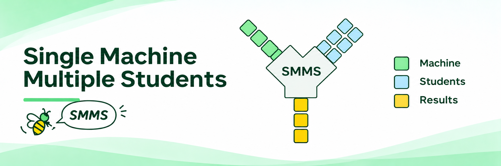

<h2 align="center"> &#x1F41D Single Machine Multiple Students</h2>

<h3 align="center">A simple but efficient user centric management system to share resources of compute.</h3>

  <a href="https://samlei.io"><b>Creator Website</b></a>

# Compute Sync

Schedule + access gate for one shared compute machine, reachable over ZeroTier.

* Web UI: current week, 4 x 6h slots per day, who is using the machine right now.
* Only **registered users** (name <-> Linux account <-> ZeroTier IP) can book / start / stop.
  A booking or session can only be removed by its creator or by the host (admin).
* Every booking needs a **planned-usage note**. "Start using now" books the current slot if it is free.
* **On the machine, only the holder of the current 6h slot can write/execute** on the shared compute
  resources. Everyone else is read-only.

## Install (Ubuntu, as root)

    sudo ZT_IP=<this machine's zerotier ip> ./setup-ubuntu.sh

Creates the layout below, adds the mounts to `/etc/fstab`, installs `compute-sync.service`.

    /srv/compute/ro            read-only + noexec view of the data   (everyone can read)
    /srv/compute/gate/         0700 root; ACL entry for the current slot holder only
    /srv/compute/gate/work     read-write view of the same data      (reachable only via the gate)
    /srv/compute/.store/data   the real data (0700 parent: no way around the two views)

Optionally gate GPUs too (default `--device '/dev/nvidia*'`); edit the unit's ExecStart for other nodes.

## Add a person

    sudo adduser alice
    sudo adduser alice compute            # the group that may use the shared data

Then open the UI **on the host**, click **Users**, enter: name, Linux account, ZeroTier IP(s).
Deleting a user removes their upcoming bookings and ends their access immediately.
`users.json` can also be edited by hand; changes are picked up without a restart.

## Rules of thumb

* Admin = requests from the host itself (127.0.0.1 or the host's own ZeroTier IP) or `--admin <ip>`.
  Register the host's IP under your own name too if you want to book from the host.
* Identity is the client IP. ZeroTier authenticates members, but check your ZeroTier flow rules if you
  need to rule out one member claiming another member's IP.
* Handover happens within `--interval` seconds (default 5) of a slot boundary, and instantly on any change.

## What it does NOT do

* It does not kill processes. A job started in your slot keeps running, and files/devices it already
  opened stay usable after handover; only new opens and new path lookups through the gate are refused.
  (A shell whose cwd is inside `gate/work` can also keep using relative paths.)
* It cannot stop a user from running programs from `/usr/bin` or their home directory; the gate covers
  the shared data tree and the configured device nodes, not the whole OS.
* If the service is stopped, the last ACLs stay in place until it starts again.
* Members of a device node's owning group (e.g. `video`, `render`) keep access to it; the admin page warns
  about this when it detects it.